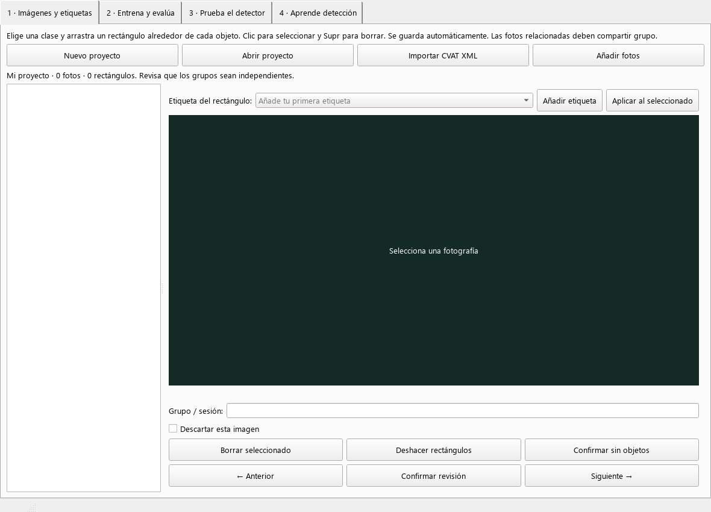

# Aula IA · Detección de objetos

Laboratorio para alumnos: **anotar imágenes con rectángulos y etiquetas propias, entrenar en Windows y utilizar el modelo desde una web en Raspberry Pi 4**.

Hay una única aplicación de detección. **Los proyectos nuevos empiezan vacíos, sin imágenes ni etiquetas predefinidas.** Añade solo lo que necesites con «Añadir etiqueta»; una única etiqueta es suficiente para un detector.



## Empezar en Windows

En otra máquina, instala Python 3.12 de 64 bits con el lanzador `py` y ejecuta `instalar_windows.cmd`. Después abre **`iniciar_objetos.cmd`**. En este equipo el entorno `.venv` ya está preparado.

```powershell
py -3.12 -m venv .venv
.\.venv\Scripts\python.exe -m pip install -r requirements-windows.txt
.\.venv\Scripts\python.exe -m aula_ia.object_desktop
```

El primer entrenamiento descarga los pesos oficiales de SSDLite en `.cache/torch`. Después pueden reutilizarse sin Internet. No se necesita una GPU; el entrenamiento usa CPU.

## Recorrido

1. **Nuevo proyecto:** elige dónde guardarlo. Empieza sin etiquetas.
2. **Añadir etiqueta:** escribe el nombre de tu objeto.
3. **Añadir fotos:** importa una carpeta y asigna su grupo o sesión de captura.
4. **Anotar:** selecciona una etiqueta y arrastra un rectángulo alrededor de cada objeto. Una imagen puede contener varios objetos y etiquetas diferentes.
5. **Revisar:** corrige las cajas o confirma que no hay objetos. Las fotos pendientes se omiten al entrenar.
6. **Entrenar:** revisa los grupos y los resultados de validación y prueba.
7. **Exportar:** copia `detector-objetos.zip`.
8. **Raspberry Pi:** carga el ZIP en la web y prueba fotos nuevas o una cámara conectada a la Pi.

Se guardan automáticamente etiquetas, rectángulos, grupos y descartes. Las fotografías originales no se modifican. Las rutas de los proyectos son locales; si mueves las fotos debes actualizar sus rutas. También se aceptan rutas relativas al JSON.

Cada etiqueta necesita objetos en al menos tres grupos; el conjunto necesita un mínimo técnico de seis imágenes revisadas. Mantén juntas las fotografías de una misma sesión, objeto o muestra. No se exige ninguna clase concreta ni ejemplos de temas ajenos a tu proyecto.

## Instalador para Raspberry Pi 4

Extrae el paquete `AulaIA-RaspberryPi.zip` en una carpeta permanente de tu usuario en la Pi y ejecuta allí, **sin sudo**:

```bash
bash instalar_raspi.sh
```

Instala dependencias para cámara USB, genera la clave y activa la web al arrancar la Pi. Para cámara por cinta CSI usa `bash instalar_raspi.sh --camera csi`. Al terminar muestra la dirección y la clave. Requiere Raspberry Pi OS ARM64, Python 3.11+ e Internet; sudo se solicita únicamente para los pasos del sistema.

Para generar el ZIP ligero en Windows:

```powershell
.\.venv\Scripts\python.exe -m scripts.crear_paquete_raspi
```

Se crea `dist/AulaIA-RaspberryPi.zip`, con el servidor y su instalador, sin entrenamiento, Qt, datasets, modelos ni el entorno de Windows. [Instrucciones completas](docs/raspberry-pi.md).

## Guías

- [Guía del alumno](docs/guia-alumno.md).
- [Editor, entrenamiento y evaluación](docs/deteccion-objetos.md).
- [Instalación y cámaras USB/CSI en Raspberry Pi 4](docs/raspberry-pi.md).
- [Arquitectura y formato del modelo](docs/arquitectura.md).
- [Verificación y límites](docs/verificacion.md).

## Demostración opcional

La demostración es un proyecto separado con dibujos y anotaciones de ejemplo. **No se carga al iniciar ni añade etiquetas a proyectos nuevos.**

```powershell
.\.venv\Scripts\python.exe -m scripts.crear_demo_objetos
```

Abre `demo-data/objetos/proyecto.json` solo si quieres practicar con ella. No representa la precisión del modelo con objetos reales.

## Conjuntos externos

Puedes importar un CVAT XML desde el editor o convertirlo por terminal:

```powershell
.\.venv\Scripts\python.exe -m scripts.importar_cvat RUTA/annotations.xml projects/importado/proyecto.json
```

El importador conserva las etiquetas que ya tienen sus rectángulos; no las añade a otros proyectos. Revisa el reparto de grupos antes de evaluar. El comando rechaza un destino existente para conservar las correcciones previas.

En Windows, **«Descargar de Kaggle…»** abre el asistente genérico de descarga. Pega un enlace de dataset o `propietario/dataset` (también `propietario/dataset/versions/N`), elige la carpeta base y pulsa **«Descargar dataset»**. No viene ligado a ningún conjunto ni clase. Muestra actividad, registro de transferencia y cancelación; al terminar muestra el número de archivos, imágenes y tamaño. Puedes abrir la carpeta o añadir sus imágenes al proyecto. Descargar no convierte las anotaciones de Kaggle ni crea etiquetas automáticamente.

Se usa [kagglehub oficial](https://github.com/Kaggle/kagglehub). Para datasets que requieren acceso, el asistente permite un token opcional: se pasa solo al proceso de descarga, sin guardarlo en el proyecto ni en archivos. También se puede usar la autenticación ya configurada en el equipo. Kaggle puede exigir aceptar condiciones o permisos en su web. Si faltan dependencias en una instalación anterior, ejecuta de nuevo `instalar_windows.cmd`.

La misma descarga está disponible por terminal:

```powershell
.\.venv\Scripts\python.exe -m pip install -r requirements-datasets.txt
.\.venv\Scripts\python.exe -m scripts.descargar_kaggle --handle propietario/conjunto
# Otra carpeta base (opcional):
.\.venv\Scripts\python.exe -m scripts.descargar_kaggle --handle propietario/conjunto --destination "D:\Mis datasets"
```

Por defecto se guarda en `datasets/propietario/conjunto/latest/` (o `version-N/`) y se genera un inventario JSON junto a esa carpeta. Datasets de distintos propietarios quedan separados. Si cancelas, pueden quedar archivos parciales para revisar o reintentar. El código, los tests y la documentación se versionan en Git; datasets, pesos, modelos exportados, proyectos locales, credenciales y entornos virtuales quedan excluidos. El conjunto de Kaggle descargado previamente permanece local como material opcional.

## Entrenar por terminal

```powershell
.\.venv\Scripts\python.exe -m scripts.entrenar_objetos projects/mi-proyecto/proyecto.json --epochs 15
```

## Verificar

```powershell
.\.venv\Scripts\python.exe -m pip install -r requirements-dev.txt
.\.venv\Scripts\python.exe -m unittest discover -v
```

Las pruebas usan imágenes y cámaras simuladas. Se comprueban anotaciones, proyectos vacíos, entrenamiento de una y varias etiquetas, exportación y predicción web. **La captura física y el rendimiento en la Pi 4 siguen pendientes de comprobar en hardware.**

`requirements-windows.lock.txt` registra las versiones verificadas en Windows; no debe usarse como lock de Linux ARM.

Referencias: [Qt para Python](https://doc.qt.io/qtforpython-6/gettingstarted.html), [SSDLite](https://docs.pytorch.org/vision/stable/models/generated/torchvision.models.detection.ssdlite320_mobilenet_v3_large.html), [exportación ONNX](https://docs.pytorch.org/docs/stable/onnx.html), [ONNX Runtime en Raspberry Pi](https://onnxruntime.ai/docs/tutorials/iot-edge/rasp-pi-cv.html).
